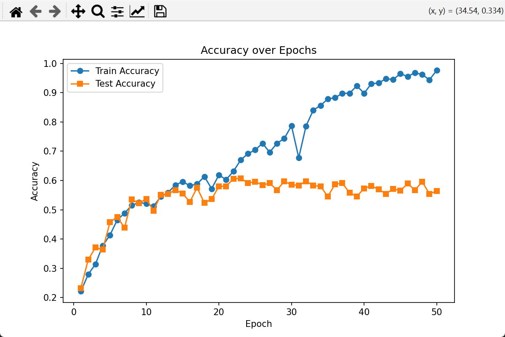
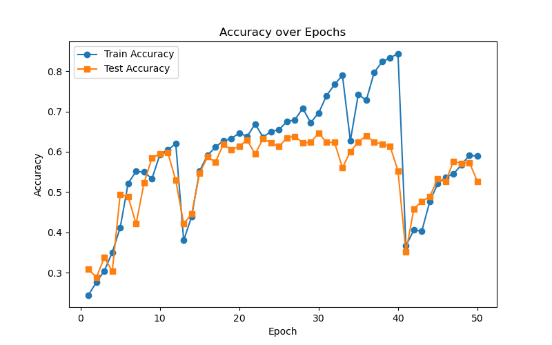

# 花卉小能手

## 初识神经网络

1.首先**读取文件并解码成像素数组**，然后**根据需要进行数据增强和尺寸调整**（方便后续输入模型和训练），再**进行归一化把整数转换成浮点数**（避免梯度爆炸），一般还需要将维度转换成**[C,H,W]**（因为输入的数据可能是[H,W,C]这种形状的），然后**组成batch**（方便一次能输入多张图片数据训练）,最后**转成张量**。

**张量**是pytorch中用来存储数据的**多维数组**，在pytorch中大部分数据，参数和结果都是用张量表示，张量的核心概念就是通过**维度**和**形状**来描述数据的结构，在运算中张量支持**广播**（即当两个形状不同的张量做逐元素运算时，框架会自动“扩展”较小形状的张量，使其形状与较大张量兼容，从而完成运算）。

2.卷积神经网络主要包括**输入层、卷积层、激活层、池化层、全连接层、输出层**。卷积层负责提取局部特征，池化层负责压缩特征，全连接层负责整合特征，激活层提供非线性化。

3.**卷积**指的是二维图像的权重矩阵的标量积，即核函数与输入中每个邻域的标量积。简单来说就是**窗口内的每个像素分别与对应的权重相乘再相加，然后移动步长个单位后以此类推进行操作**。

两者有区别：数学中的卷积是**将核旋转180°后再滑动相乘相加**，而神经网络中的卷积则不用将核翻转，神经网络中的“卷积”实际上做的是**互相关**。

**卷积核**是一个小的权重矩阵，与像素相乘相加，就像是一个窗口；**步长**决定卷积核每次滑动的格数。

4.**池化**是深度学习中的一种重要操作，主要用于**降低特征图的空间维度**（高度和宽度），同时保留最重要的特征信息。池化操作通过减少参数数量和计算量来防止过拟合，并提高模型的平移不变性。**与卷积层不同，池化层没有可学习的参数，只有超参数如核大小、步长和填充**。

常见的池化类型包括**最大池化（Max Pooling）** 和**平均池化（Average Pooling）**

**平均池化对窗口内每个像素取平均值作为输出**，有助于**提供更平滑的特征表示**；**最大池化则取窗口中最大值作为输出**，**突出了重要信息**。

**感受野**就是指输出特征图上某个元素受输入图像上影响的区域，如一张原始图片经过两次3x3的卷积后，特征图上的感受野就是5x5。

5.**激活层**的作用是**给神经网络加入非线性，让它能拟合复杂函数，而不是只会做线性变换。**因为卷积操作本质还是线性运算。

最后神经网络输出的是一个张量，具体内容根据任务决定，例如在本题中输出花卉种类。

------------

## 数据预处理

**数据集中存在异常或者损坏的图片时可以用以下代码清除**

```python
EXTS = ('.jpg', '.jpeg', '.png', '.bmp', '.webp') 
for folder in [train_dir, test_dir]: # 找出坏图
    for root, _, files in os.walk(folder):
        for file in files:
            if file.lower().endswith(EXTS):
             path = os.path.join(root, file)
             try:
                 with Image.open(path) as img:
                     img.verify()  
             except Exception:
              os.remove(path)
```

`EXTS = ('.jpg', '.jpeg', '.png', '.bmp', '.webp')`这一步为后面筛选文件定义扩展名。

`os.walk(folder)` 会递归遍历 `folder` 下所有子目录，每次返回一个三元组：

- `root`：当前目录路径；
- `dirs`：当前目录下的子目录名列表；
- `files`：当前目录下的文件名列表。

这里用 `_` 接收 `dirs`，表示不关心子目录列表，因为递归遍历会自动进入子目录。

`file.lower().endswith(EXTS)`将大写字母全转换成小写字母，判断拓展名

`with`保证图片文件句柄在 `verify()` 结束后都会被关闭。

`img.verify()`检查图片是否完整

**数据增强并调整图片大小**

```python
train_transforms = transforms.Compose([
    transforms.Resize((224, 224)),
    transforms.RandomHorizontalFlip(p=0.5),
    transforms.ToTensor(),
    transforms.Normalize([0.485, 0.456, 0.406], [0.229, 0.224, 0.225])
])

test_transforms = transforms.Compose([
    transforms.Resize((224, 224)),
    transforms.ToTensor(),
    transforms.Normalize([0.485, 0.456, 0.406], [0.229, 0.224, 0.225])
])
```

`transforms.Compose()`的作用是把多个变换按列表顺序串成一个流水线，上一个操作的输出成为下一个操作的输入

`transforms.Resize((224, 224))`将图片缩放到224 x 224 ,方便后面进入CNN 

`transforms.RandomHorizontalFlip(p=0.5)`以概率 `p` 水平翻转图片

还有以下数据增强方法

```python
transforms.RandomResizedCrop(224, scale=(0.8, 1.0))  # 随机裁剪+缩放
transforms.ColorJitter(brightness=0.2, contrast=0.2, saturation=0.2)  # 颜色抖动
transforms.RandomRotation(15)  # 随机旋转 ±15°
```

`transforms.ToTensor()`把 PIL Image 转成 PyTorch Tensor

这一步进行了维度转换，类型转换，归一化三步操作

 `transforms.Normalize([0.485, 0.456, 0.406], [0.229, 0.224, 0.225])`对每个通道做标准化

`mean=[0.485, 0.456, 0.406]`：R、G、B 三个通道的均值；

`std=[0.229, 0.224, 0.225]`：R、G、B 三个通道的标准差。

这些数据来自**ImageNet 训练集**上统计的每通道均值和标准差,具有代表性

**划分数据集**

```python
train_dataset = datasets.ImageFolder(root='./flowers/train', transform=train_transforms)
test_dataset = datasets.ImageFolder(root='./flowers/test', transform=test_transforms)
```

`datasets.ImageFolder`能自动生成**类别映射和样本列表，取样本时读图并应用 transform，返回 `(image, label)`**。这里的文件结构符合使用规范并且数据集和测试集都已经划分好，所以相比于手写datasets更加方便快捷。

```python
train_loader = DataLoader(train_dataset, batch_size=64, shuffle=True, num_workers=0,drop_last=False)
test_loader = DataLoader(test_dataset, batch_size=64, shuffle=False, num_workers=0,drop_last=False)
```

然后使用DataLoader传入数据，`batch_size`表示每轮训练传入的数据数量;`shuffle`表示是否打乱数据;`num_workers`表示多进程;`drop_lost`决定最后一个不完整的batch是否丢弃。

## 炼丹

1.

- **超参数**是你在开始训练之前需要人为设定的参数。由人来设定。一般来说包括**学习率，batch size,优化器等**。

- **优化器**是一种根据计算出的梯度，决定如何更新模型的权重参数的算法。主要有**梯度下降法**、**动量优化法**和**自适应学习率**等类型。**梯度下降法**是最基础的方法，其缺点是训练速度较慢，容易陷入局部最优解；**动量优化法**在基础的梯度下降中引入**动量**（类似于拥有了“惯性“），使收敛速度更快，帮助逃出局部最小，但同时仍然存在对学习率敏感的问题；**自适应学习率**会根据不同的参数和不同的训练阶段使用不同的学习率，对初始学习率依赖性没有前两者强。

- **Dataset**用来打包数据，获取数据样本图像和标签，相当于一个储存数据的“仓库”，能根据编号找出相应的数据；**DataLoader**用来读取数据，想当于来仓库取数据的“人“，决定每次取多少个数据，是否要打乱顺序等。

2.下面是网络结构

```python
class Mymodel(nn.Module):
    def __init__(self):
        super(Mymodel, self).__init__()
        self.conv1 =nn.Conv2d(in_channels=3, out_channels=96, kernel_size=(11,11), stride=4,padding=2)
        self.pool1 = nn.MaxPool2d(kernel_size=(3,3),stride=2)

        self.conv2 = nn.Conv2d(in_channels=96, out_channels=256, kernel_size=5, padding=2),
        self.pool2 =nn.MaxPool2d(kernel_size=3, stride=2)

        self.conv3 =nn.Conv2d(in_channels=256, out_channels=384, kernel_size=3, padding=1),
        self.conv4 =nn.Conv2d(in_channels=384, out_channels=384, kernel_size=3, padding=1),
        
        self.conv5 =nn.Conv2d(in_channels=384, out_channels=256, kernel_size=3, padding=1),
        self.pool3 =nn.MaxPool2d(kernel_size=3, stride=2)

        self.fc1 =nn.Linear(256 * 6 * 6, 4096)
        self.fc2 =nn.Linear(4096, 4096)
        self.fc3 =nn.Linear(4096, 18)
        self.relu = nn.ReLU()
    def forward(self, x):
        x = self.conv1(x)
        x = self.pool1(x)
        x = self.relu(x)
        
        x = self.conv2(x)
        x = self.pool2(x)
        x = self.relu(x)

        x = self.conv3(x)
        x = self.relu(x)

        x = self.conv4(x)
        x = self.relu(x)

        x = self.conv5(x)
        x = self.pool3(x)
        x = self.relu(x)
        
        x = x.view(x.shape[0],-1) 
        x = self.fc1(x)
        x = self.relu(x)

        x = self.fc2(x)
        x = self.relu(x)

        x = self.fc3(x)
        x = self.relu(x)
        return x
```

3.准确率变化曲线



test准确率保持在0.5左右，应该是发生了过拟合，尝试采取dropout



但似乎没有解决问题
